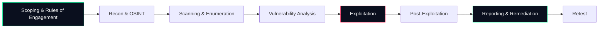
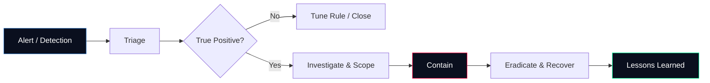

<div align="center">


<br/>


[](https://github.com/Ranty1-cloud)
[](mailto:muuovictor18@gmail.com)

</div>

---

## ⚡ `~/about`

```bash
┌──(victer㉿kali)-[~]
└─$ cat profile.json
```

```json
{
  "name": "Katungwa Victer Muuo",
  "alias": "Ranty1-cloud",
  "location": "Nairobi, Kenya",
  "languages": ["English", "Swahili"],
  "roles": [
    "Full-Stack Software Engineer",
    "Ethical Hacker / Red Teamer",
    "Penetration Tester",
    "SOC Analyst (Blue Team)"
  ],
  "specialties": [
    "Web application security (OWASP Top 10)",
    "Network & infrastructure pentesting",
    "Threat detection, hunting & incident response",
    "Secure full-stack development (Supabase, Next.js, Node.js)",
    "Security automation with Python & Bash"
  ],
  "philosophy": "Think like an attacker. Build like a defender.",
  "ethics": "Authorised testing only. Responsible disclosure always.",
  "open_to": ["Remote roles", "Contracts", "Bug bounty", "Security consulting"]
}
```

I build full-stack applications, then break them the way a real attacker would. In the **SOC** I detect, triage and investigate the same kinds of attacks. Working on both sides of the fence makes my code safer and my defences smarter.

---

## 🧰 `~/arsenal`

### 💻 Engineering

<p align="left">
  
</p>

### 🔴 Red Team / Offensive


### 🔵 Blue Team / SOC


### 🧪 Training Grounds


---

## 🎯 `~/methodology`

<details open>
<summary><b>🔴 Penetration Testing Workflow</b></summary>



</details>

<details open>
<summary><b>🔵 SOC Incident Response Workflow</b></summary>



</details>

<details>
<summary><b>🗺️ MITRE ATT&CK Coverage Focus</b></summary>

| Tactic | Focus Areas |
|---|---|
| Reconnaissance | OSINT, DNS & subdomain enumeration, service fingerprinting |
| Initial Access | Web app flaws, weak auth, exposed services, phishing awareness |
| Execution & Persistence | Detection of suspicious process and scheduled task activity |
| Privilege Escalation | Misconfigurations, weak permissions, credential exposure |
| Credential Access | Password policy testing, hash analysis (authorised) |
| Lateral Movement | Network segmentation review, Active Directory attack paths |
| Detection & Response | Sigma/YARA rules, SIEM correlation, threat hunting |

</details>

<details>
<summary><b>🛡️ Web App Security Checklist (OWASP Top 10)</b></summary>

- [x] Broken access control & IDOR testing
- [x] Authentication and session management flaws
- [x] Injection (SQL, NoSQL, command) testing
- [x] Cross-site scripting (XSS) and CSRF
- [x] Security misconfiguration and exposed secrets
- [x] Row Level Security (RLS) review for Supabase apps
- [x] Vulnerable and outdated dependencies
- [x] SSRF, file upload and API security checks
- [x] Logging, monitoring and rate limiting

</details>

---

## 🚀 `~/projects`

<table>
  <tr>
    <td width="50%" valign="top">

### ⛪ Free Baptist Church Kenya
Production web platform with **Supabase authentication**, deployed on Vercel with a custom domain.

`Next.js` `Supabase` `Auth` `Vercel`

🔗 [Live Site](https://freebaptistchurchkenya.co.ke) · [Repo](https://github.com/Ranty1-cloud/fbc)

</td>
    <td width="50%" valign="top">

### 🚐 JAVS OF NAIROBI
Kenyan adventure travel platform built around **Nganya culture**, with a booking system.

`Full-Stack` `Booking` `Web App`

🔗 [Repo](https://github.com/Ranty1-cloud/javsofnairobi)

</td>
  </tr>
  <tr>
    <td width="50%" valign="top">

### 🎨 Ranty Portfolio
Personal portfolio with a **Supabase-backed admin portal** for managing content securely.

`Supabase` `Admin Portal` `Auth`

🔗 [Repo](https://github.com/Ranty1-cloud/ranty-portfolio)

</td>
    <td width="50%" valign="top">

### 🔐 Security Lab *(in progress)*
A home lab for practising attacks and detections: vulnerable targets, a SIEM, and custom detection rules.

`Kali` `Wazuh` `Docker` `Sigma`

</td>
  </tr>
</table>

---

## 📊 `~/stats`

<div align="center">


</div>

---

## 🐍 `~/contributions`

<div align="center">
  
</div>

---

## 🎯 `~/currently`

- 🔭 Building secure full-stack apps with Next.js and Supabase
- 🧪 Practising on TryHackMe, Hack The Box and PortSwigger labs
- 📡 Writing detection rules (Sigma, YARA) and tuning SIEM alerts
- 📝 Documenting findings and write-ups
- 🤝 Looking for remote pentesting, SOC and full-stack roles

---

## 🧠 `~/principles`

```text
[+] Attacker mindset, defender discipline
[+] Security by design, not as an afterthought
[+] Least privilege everywhere
[+] If it isn't documented, it didn't happen
[+] Scope first. Permission always. Disclose responsibly.
```

---

## 📫 `~/contact`

<div align="center">

[](mailto:muuovictor18@gmail.com)
[](https://github.com/Ranty1-cloud)

```bash
┌──(victer㉿kali)-[~]
└─$ echo "Let's build something secure."
Let's build something secure.
```


</div>
